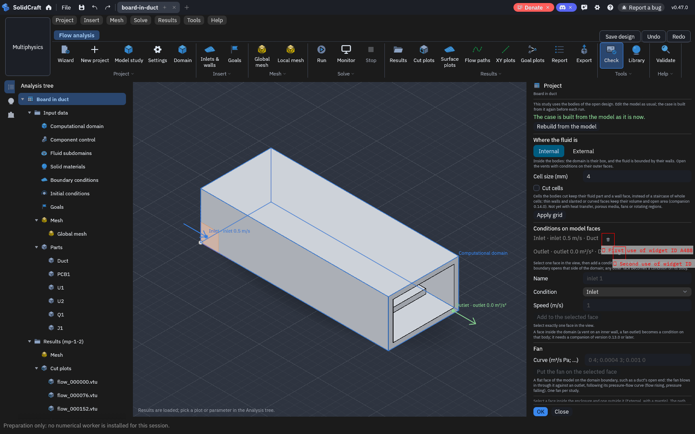

# Getting started

## What you need

- **SolidCraft**, built from source or installed.
- **The solver companion**, `cfd-solve`, from *cfd-solvers-rs* 0.16.0. It is a separate
  program that SolidCraft starts for each run; it is not linked into SolidCraft. Without it you
  can still set up studies, check them, export their cases and read results kept in a design,
  but not run new ones.

The complete source archive holds the companion in `companion/cfd-solvers-rs`. The scripts
`scripts/run-multiphysics.sh` (Linux, macOS) and `scripts\run-multiphysics.bat` (Windows) build
it and start SolidCraft with its path set.

To start them yourself, tell SolidCraft where the companion is:

=== "Linux and macOS"

    ```sh
    export SOLIDCRAFT_CFD_SOLVE=/absolute/path/to/cfd-solve
    solidcraft
    ```

=== "Windows"

    ```powershell
    $env:SOLIDCRAFT_CFD_SOLVE = 'C:\tools\cfd-solve.exe'
    solidcraft
    ```

A `cfd-solve` on your `PATH` is found as well. The browser version of SolidCraft prepares and
checks studies but cannot start a local program.

## Open the workspace

Choose **Multiphysics** in the workspace menu at the top left. The workspace has:



| Area | What it holds |
|---|---|
| **Ribbon** (Flow analysis tab) | Project (Wizard, New project, Model study, Settings, Domain), Insert, Mesh, Solve (Run, Monitor, Stop), Results, Tools (Check, Library), Help |
| **Analysis tree** (left) | Every study of the design. The active one opens into Input data (domain, materials, conditions, goals, mesh, **Parts**) and Results (the loaded run's plots and tables) |
| **Graphics window** (centre) | The design, with the study's domain, conditions and results drawn on it |
| **Property panel** (right) | The settings of the tree node you picked |
| **Status bar** | What the solver is doing, and the last notice |

Picking a node in the tree opens its panel; picking a part in the tree, the component table or
the 3-D view picks it in all three.

## Try the example

The example design used by the tutorials is
[`board-in-duct.sc`](examples/board-in-duct.sc). Open it with **File › Open**, switch to
Multiphysics and pick **Parts** in the tree. It already holds two runs, so every results page
works without the solver.

Next: [Tutorial 1, a board in a duct](tutorials/board-in-duct.md), builds the same design from
nothing.
