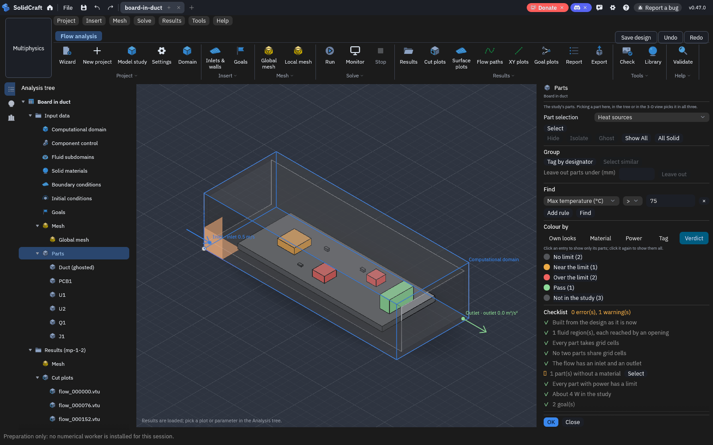

# SolidCraft Multiphysics

Multiphysics is SolidCraft's workspace for **airflow and heat** in the design you are drawing.
A *study of the model* takes the design's own bodies as its geometry, so there is no export,
no copy and no second model to keep in step: change a part, and the study is built from the
change the next time it runs.

*The example used throughout these pages: a board with three heat-producing parts in an air
duct. The duct is drawn see-through, and the parts are coloured by their verdict from a real
run at 0.5 m/s: amber is near its limit, red is over it, green passes.*

## What you can do

| | |
|---|---|
| **Set up** | Air inside or around the bodies, inlets and outlets on faces of the model, heat in parts and on faces, temperature limits, goals |
| **Organise** | Tag parts, group a board's parts by reference designator, live part selections, leave out parts too small for the grid |
| **Check** | A checklist before a run: fluid regions and openings, parts lost from the grid, parts without a material or a limit |
| **Run** | The native solver companion runs the case in its own process; results are kept in the design with the exact input they came from |
| **Read** | Component table with margins and verdicts, colour by verdict or power, Find with rules on setup and results, cut and surface plots on the model, batch reports over several runs |

## How these pages are organised

- **[Getting started](getting-started.md)**: run SolidCraft with the solver and open the
  workspace.
- **[Tutorials](tutorials/index.md)**: one example, from an empty design to a report comparing
  two runs. Each step names the button and the command behind it.
- **[Theory of operation](theory/index.md)**: what happens between the design and the
  numbers: how the case is built, what the solver solves, how results are matched back to
  parts, and how the 3-D view stays fast with many parts.
- **[Reference](reference/commands.md)**: every command, and the words these pages use.

!!! note "Every picture here is real"
    The pictures are drawn by SolidCraft itself, on the GPU, from the
    [example design](examples/board-in-duct.sc), which holds two real runs of the solver
    companion. [Making this site](reference/making-this-site.md) shows how to make them again.
