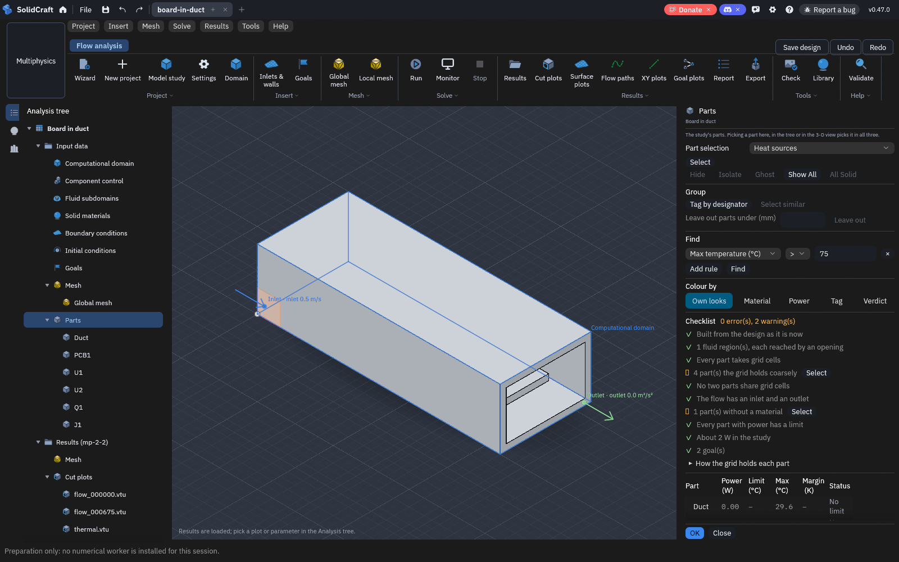

# 1. Board in a duct

You will draw a small duct with a board inside it, make a study of the model, give it air and
heat, and run it.

## Draw the design

In the **Design** workspace, draw these boxes (sizes in millimetres; *corner* is the box's
lowest corner):

| Body | Size (L × W × H) | Where |
|---|---|---|
| Duct | 160 × 60 × 40 | corner at the origin |
| *(cut)* | 170 × 52 × 32 | centred on the duct, as a cut: this hollows it and opens both ends |
| PCB1 | 120 × 44 × 4 | corner at (20, 8, 6) |
| U1 | 14 × 14 × 5 | on the board at x 45, y 30 |
| U2 | 10 × 10 × 5 | on the board at x 80, y 20 |
| Q1 | 8 × 8 × 5 | on the board at x 105, y 38 |
| J1 | 8 × 20 × 10 | on the board at x 130, y 30 |
| C1, C2, R1 | 3 × 1.6 × 1.6 (R1: 0.8 high) | on the board |

Name each body as in the table (the names are reference designators, which
[tutorial 5](imported-assemblies.md) uses).

!!! note "Why the parts are at least 4 mm tall"
    The study's grid has 4 mm cells. A part thinner than a cell holds no cell centre and is
    lost from the grid. The passives show what happens then.

## Make a study of the model

Switch to **Multiphysics** and press **Model study** (Project group). Choose:

- **Internal**: the air is *inside* the bodies, here inside the duct. The domain is the
  bodies' exact bounding box.
- **Cell size** 4 mm.

The study appears in the Analysis tree. Its case is built from the design straight away: a
grid of 40 × 15 × 10 cells, with every body voxelised into it.

??? info "The command"
    `multiphysics.model.create {"name": "Board in duct", "analysis": "internal", "cell_mm": 4}`

## Inlet and outlet

Pick **Boundary conditions** in the tree. In the 3-D view, pick the duct wall's end face at
x = 0 and make it an **Inlet** at 1.0 m/s; pick the end face at x = 160 and make it an
**Outlet** at pressure 0. A flat face on the domain's boundary opens that whole side, so the
duct's open end becomes the opening.

??? info "The commands"
    ```json
    {"command": "multiphysics.model.condition", "params": {"id": "…", "expected_revision": 3,
     "name": "Inlet", "face": {"body": "Duct", "point": [0, 30, 2]},
     "role": {"kind": "inlet", "speed_m_per_s": 1.0}}}
    ```
    and the same with `"role": {"kind": "outlet", "pressure_m2_per_s2": 0}` at x = 160.
    `expected_revision` is the study's revision you last read: an edit based on an older
    one is refused instead of overwriting someone else's change.

## Heat, materials and limits

Pick **Solid materials** and turn **Heat transfer** on, with air entering at 25 °C. Then, for
each group of parts, pick them in the view and give them a material:

| Parts | Conductivity (W/(m·K)) | Power (W) | Limit (°C) |
|---|---|---|---|
| U1 | 150 | 0.8 | 85 |
| U2 | 150 | 0.5 | 85 |
| Q1 | 150 | 0.4 | 75 |
| J1 | 0.3 | – | 85 |
| PCB1 | 10 | – | – |
| C1, C2, R1 | 1 | – | 105 |

Power is released evenly through the part's volume. A limit is the temperature a part must
stay below; the run reports each part's margin to it.

## Check the setup

Pick **Parts** in the tree. Its panel lists every part of the study with its setup, and below
it a **Checklist**:



Here it warns that one part has no material (the duct itself conducts like the starter
material, which is fine for a thin wall), and, before the step below, that **3 parts are
thinner than a cell**: C1, C2 and R1.

## Leave out the parts the grid cannot hold

Under **Group**, type **4** in *Leave out parts under (mm)* and press **Leave out**. The study
now keeps only the parts whose largest side is at least 4 mm, through a live part selection
of its own, *Board in duct without small parts*. The passives keep their materials; if the
grid is made finer, they can come back.

??? info "The command"
    `multiphysics.model.leave_out_small {"id": "…", "expected_revision": …, "below_mm": 4}`

!!! note "What happens without this step"
    With heat on, the passives are **lumped**: each one's power goes into the cells it lies in
    and its temperature is read there (see [partial cells](../theory/design-to-case.md#partial-cells)).
    That keeps their power in the study, but a 1 mm part's temperature is then that of a 4 mm
    cell of air and board around it. Leaving them out says plainly that they are not modelled.

## Fluid and run length

A new study is air at 20 °C, run for two seconds of flow and stopped early once its goals
settle; **Fluid and run**, at the bottom of the **Mesh** panel, changes them. The flow is
laminar, as in every study of the model: at 1 m/s in this duct that is a fair picture, at
several metres per second a fan-cooled board's air is turbulent and cools better than a
laminar study says.

## Run

Press **Run** (Solve group). The status bar shows the solver working; **Monitor** shows its
progress. When it finishes, press **Keep result** to store the run in the design: until then
it is only in this session's history. The example's run at 1.0 m/s took about two minutes.

??? info "The commands"
    `multiphysics.run.start {"id": "…"}`, then `multiphysics.run.status {}` until the job
    says `succeeded`, then `multiphysics.run.keep {"job_id": "…"}`.

Save the design. Next, [read the results](reading-results.md).
