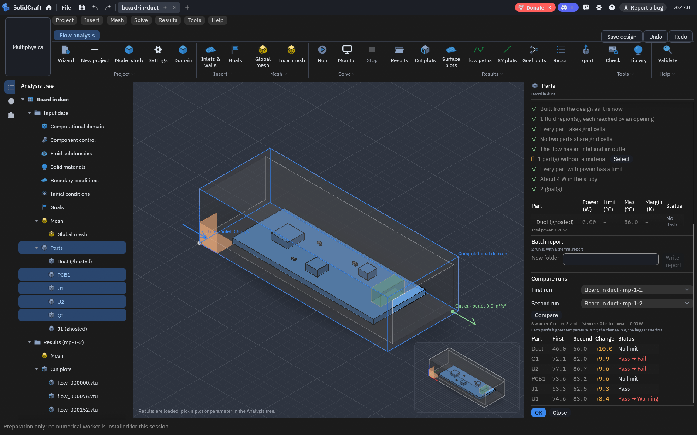

# 4. Comparing runs

One run answers one question. To see what the inlet speed does, run the study again at
0.5 m/s and compare.

## A second run

Pick **Boundary conditions**, pick the inlet face and set its speed to **0.5 m/s**. The study's
revision goes up, and the first run is now *historical*: it was made from the study as it
was. It keeps its own input case, so its results still mean what they meant; the panels mark
it as made from an older setup.

Run again and keep the result. The study now holds both runs.

## The batch report

Under the component table in the Parts panel, **Batch report** takes the component table of
every run that kept a thermal report, oldest first. Type a new folder's name and press
**Write report**. The folder gets:

| File | What it holds |
|---|---|
| `report.html` | A page that needs nothing else: each run's total power, hottest part, least margin and pass / warn / fail counts, then each part's highest temperature per run, coloured by its verdict, and a picture of each run's parts by verdict |
| `report.csv` | Every part's numbers per run: power, limit, highest and mean temperature, margin, verdict |
| `run-1.png`, `run-2.png`, … | Each run's parts in their verdict colours, iso view (when SolidCraft can draw pictures, which it always can in the app) |

Anyone may read a report, whatever their colour vision, so its pictures draw verdicts in blue
(pass), yellow (warn) and vermilion (fail), which every eye tells apart, and a part without a limit
or a result see-through grey, so an enclosure does not hide what is inside it. In the page each temperature also says its verdict in words, so no cell leans
on colour alone.

The example's report: [report.html](../examples/report/report.html),
[report.csv](../examples/report/report.csv).

| Run | Inlet | Hottest part | Max (°C) | Least margin | Pass | Warn | Fail |
|---|---|---|---|---|---|---|---|
| mp-1-1 *(older setup)* | 1.0 m/s | U2 | 77.1 | Q1, 2.9 K | 4 | 0 | 0 |
| mp-1-2 | 0.5 m/s | U2 | 86.7 | Q1, −7.0 K | 1 | 1 | 2 |

Halving the inlet speed raises every part by 8 to 10 K, and three of the four parts with
limits stop passing. Q1 has the least margin in both runs, though U2 is the hottest: Q1's
limit is 10 K lower.

!!! note "The report never edits the design"
    It reads kept runs only, and writes into a new folder (an existing one is refused, so
    nothing is overwritten). Writing fails as a whole: a folder half written is removed.

??? info "The command"
    `multiphysics.result.report {"id": "…", "directory": "/path/to/new-folder"}`; or
    `"inline": true` to have the CSV and HTML returned instead of written; `run_ids` to pick
    the runs and their order (at most 64).

## Two runs part by part

The report puts every run side by side; **Compare runs**, under it, takes two and lines them up
part by part. Pick the **First run** and the **Second run** and press **Compare**. The runs
can be of this study (two operating points, as here) or of two studies of the model: a study
and its clone with a part moved, or two points of a sweep. Parts are matched by name.

Each part's highest temperature in both runs, the change, and its verdict, the largest rise
first. A rise is amber and a fall green; a verdict that got worse is red (**Pass → Fail**),
one that got better green. The line above the table counts the parts warmer, cooler, worse
and better, and gives the change in total power: none here, as only the airflow changed.
Changes under 0.05 K count as none.

| Part | First (°C) | Second (°C) | Change (K) | Verdict |
|---|---|---|---|---|
| Q1 | 72.1 | 82.0 | +9.9 | Pass → Fail |
| U2 | 77.1 | 86.7 | +9.6 | Pass → Fail |
| J1 | 53.3 | 62.5 | +9.3 | Pass |
| U1 | 74.6 | 83.0 | +8.4 | Pass → Warning |

??? info "The command"
    `multiphysics.result.compare {"first": {"id": "…", "run_id": "mp-1-1"}, "second":
    {"id": "…"}}`: a side without `run_id` takes its study's latest run with a thermal report.
    `"csv": true` adds the comparison as CSV, one line per part.

To see the change *where* it happens rather than per part, lock the colour range of the cut
plot ([cut and surface plots](plots.md)) and show the same plane in both runs: one scale, so
the colours mean the same temperature in both.

## Is the grid fine enough?

A temperature from one grid is that grid's answer. **Mesh study**, at the bottom of the Parts
panel, tells how much of it is the grid's:

1. Press **Make the mesh study**. Two copies of the study appear, *· mesh ×1.41* and
   *· mesh ×2*: the same setup with base cells √2 and 2 times as large (about 2.8 and 8 times
   fewer cells; a little larger where whole cells would leave two grids less than 1.35 apart),
   built and checked; nothing runs.
2. Run all three studies and keep their results.
3. Press **Check convergence**.

For each part, the table gives its highest temperature on the fine grid, the **settled**
temperature the three grids point to, the **grid index** (the band, as a share of the fine
grid's rise above the inflow, that the grid-independent answer is expected in) and the
observed **order** of convergence. Under about 5 % is settled enough for most designs; a part
marked *not settling* changes more on the fine pair of grids than on the coarse one, so the
grids are still too coarse for it: refine around it and make the study again.

??? info "The commands, and the method"
    `multiphysics.model.mesh_study {"id": "…"}`, then
    `multiphysics.result.convergence {"fine": {"id": "…"}, "medium": {"id": "…"}, "coarse": {"id": "…"}}`.
    The index is the grid convergence index of Celik et al. (2008), on each part's rise above
    the inflow: Richardson extrapolation with the order the three grids show, and a safety
    factor of 1.25. Grids whose sizes differ by less than 1.3 are noted.

Next: [imported assemblies](imported-assemblies.md).
