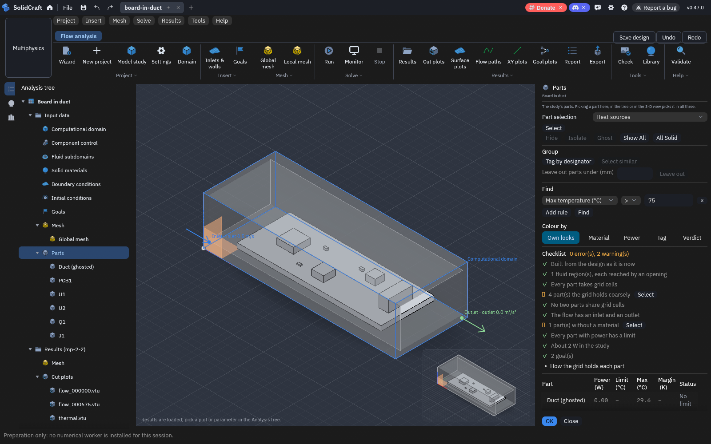

# Tutorials

The tutorials follow one design from an empty window to a report that compares two runs:

*A 160 × 60 × 40 mm duct with 4 mm walls, open at both ends. Inside it, a board (PCB1) with two
ICs (U1, U2), a transistor (Q1), a connector (J1) and three small passives (C1, C2, R1). Air
enters at one end at 1.0 m/s, and then at 0.5 m/s. U1, U2 and Q1 release 0.8, 0.5 and 0.4 W.*

| # | Tutorial | You will learn |
|---|---|---|
| 1 | [Board in a duct](board-in-duct.md) | A study of the model: inlet and outlet on faces, heat on, materials, power and limits, leaving out parts too small for the grid, running |
| 2 | [Reading the results](reading-results.md) | The component table, colour by verdict, Find with rules on results, ghosting parts |
| 3 | [Cut and surface plots](plots.md) | Plots on the model, a plane through the hottest point or a picked part, colour maps and ranges |
| 4 | [Comparing runs](comparing-runs.md) | A second run at another inlet speed, and a batch report over both |
| 5 | [Imported assemblies](imported-assemblies.md) | Tags from reference designators, similar parts, part selections, modules for every copy of a component |
| 6 | [Scripting a study](scripting.md) | The same study built and run by commands, from a script or an AI agent |
| 7 | [Climate, humidity and dust](climate-and-dust.md) | A KiCad board in its printed case through a year: surroundings, dust, a climate of day and season, condensation and where dust settles |

Each step gives the button to press and, in a note, the command it runs. Everything the
buttons do is a command, so a script can do it too.

!!! tip "Skip ahead"
    Open [`board-in-duct.sc`](../examples/board-in-duct.sc) to start any tutorial from the
    finished design: it holds both runs.
