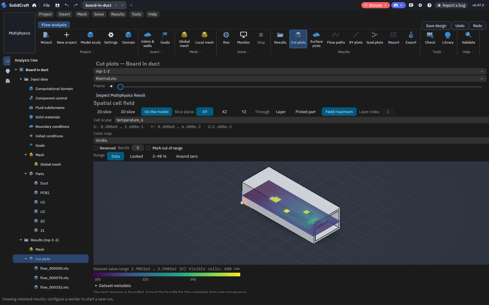
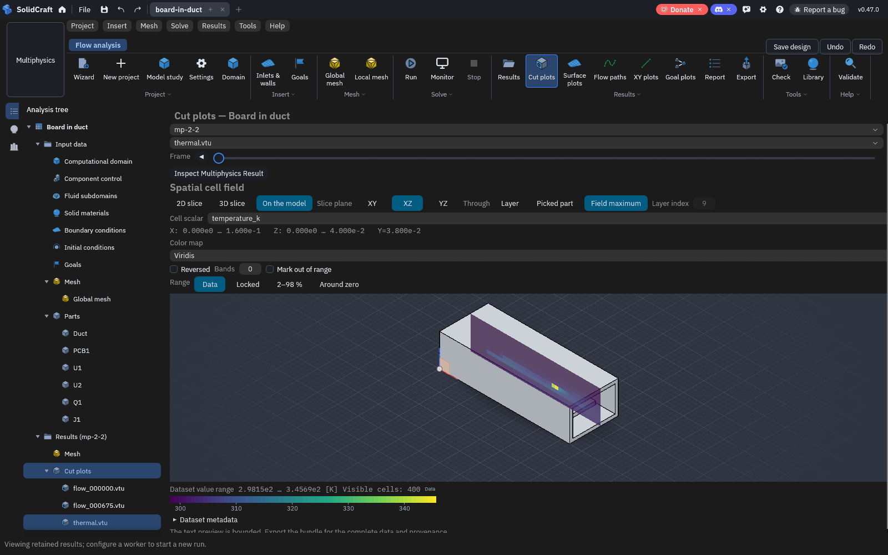
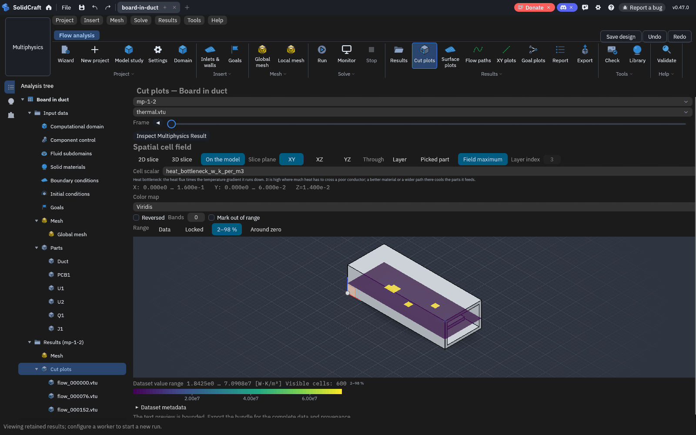
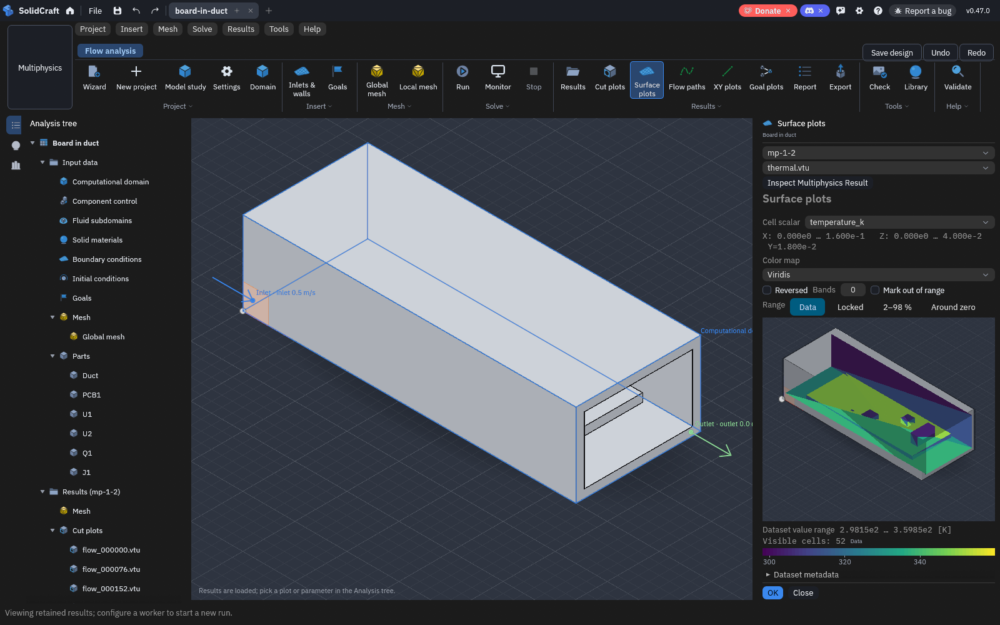

# 3. Cut and surface plots

The tables say how hot each part gets; the plots say where the heat goes.

## A cut plot on the model

In the tree, open **Results › Cut plots** and pick the run's `thermal.vtu` file. Choose **On
the model**: the plot is drawn on its plane in the design's own 3-D view, with the design's
camera.

| Control | What it does |
|---|---|
| **Slice plane** XY, XZ, YZ | The plane's orientation: across one axis of the grid |
| **Through** | What the plane goes through: a **Layer** you type, the **Picked part** (its centre), or the **Field maximum** (the cell where the plotted field is largest) |
| **Cell scalar** | The field: here `temperature_k`; for a flow file, speed, velocity or pressure |
| **Colour map** | Viridis, Turbo, cool–warm, thermal or grayscale; **Reversed**; **Bands** (2–32 bands of one colour each, 0 for smooth) |
| **Mark out of range** | Values outside the range get a colour of their own instead of the map's end colour |
| **Range** | **Data** (lowest to highest), **Locked** (typed values), **2–98 %** (a few extreme cells no longer wash out the plot), **Around zero** (for signed fields) |

Here the plane goes **through the field maximum**: the layer at z = 14 mm, through the three
heat sources. It is worked out again for every run, field and plane, so it follows the
hottest point when you switch runs. Change the plane to XZ and the plot turns to the
duct's length, still through the hottest point:

**Picked part** works the same way with the part picked in the tree, the table or the 3-D
view: pick U2 in the component table and the plot moves to its centre. Its centre comes from
the part's exact bounding box, not from its mesh.

!!! tip "One scale for several plots"
    Lock the range (say 25 to 90 °C) before you switch runs: both runs are then drawn on one
    scale, and the colours compare directly.

## Where conduction struggles

A thermal result has one more field than the solver wrote: **heat_bottleneck_w_k_per_m3**.
Pick it in **Cell scalar** with **Field maximum** on, and the plane goes through its peak. Use
the **2–98 %** range: its peaks are sharp, and a few cells would otherwise take the whole
scale.

The board lights up under each chip. The chips conduct well (150 W/(m·K)); the board under
them does not (10 W/(m·K)), so the heat they make piles up there before it spreads. That is
where a change pays: thermal vias or a copper plane under the chip, a thicker board, a heat
spreader. Changing the chip's own material would barely move it.

## A surface plot

**Results › Surface plots** colours each face of the model that touches the air by the fluid
cell next to it. Faces with no air beside them, such as the duct's outer faces, are drawn
see-through so the wetted faces behind them show.

A click on a coloured face, or on a cut plot, probes the result there: a marker and the value
on the model, and the point goes into **Point parameters**.

Next: [comparing runs](comparing-runs.md).
