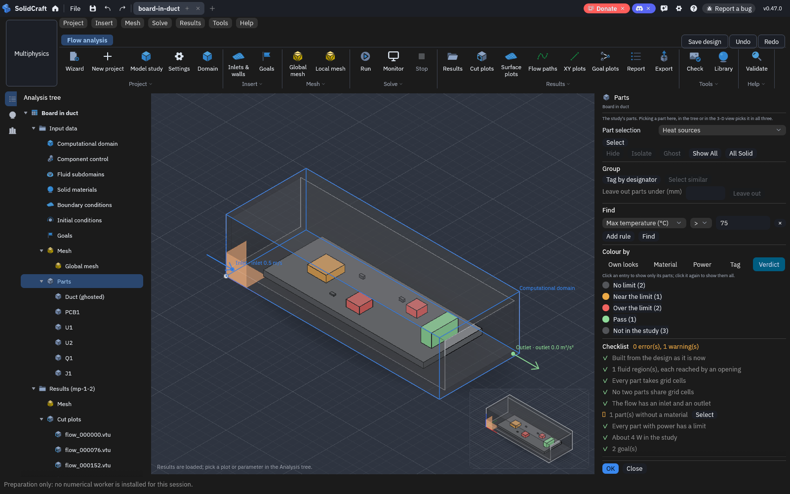
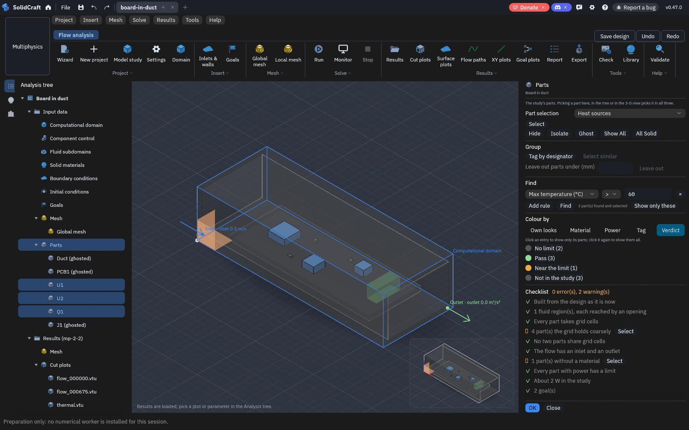
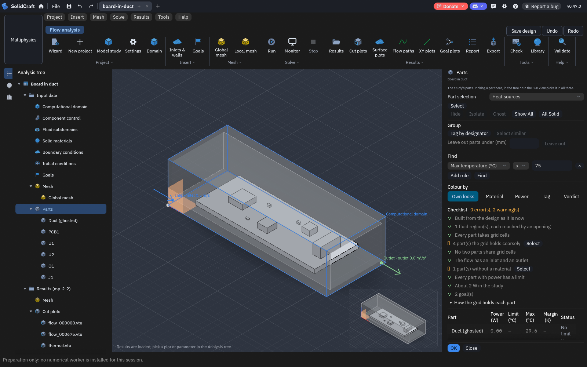
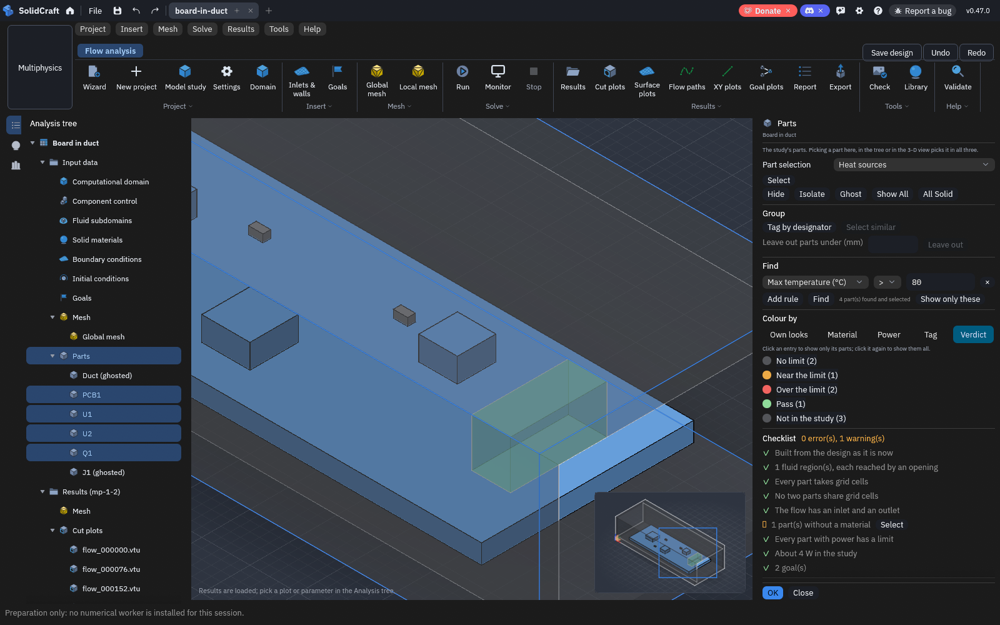

# 2. Reading the results

With a run kept, the **Parts** panel joins each part's setup to its result. This tutorial uses
the example's run at 0.5 m/s, where some parts run too hot.

## The component table

At the bottom of the Parts panel, one row per part of the study:

| Part | Power (W) | Limit (°C) | Max (°C) | Margin (K) | Status |
|---|---|---|---|---|---|
| Duct | 0 | – | 56.0 | – | no limit |
| PCB1 | 0 | – | 83.2 | – | no limit |
| U1 | 2.0 | 85 | 83.0 | 2.0 | **warn** |
| U2 | 1.2 | 85 | 86.7 | −1.7 | **fail** |
| Q1 | 1.0 | 75 | 82.0 | −7.0 | **fail** |
| J1 | 0 | 85 | 62.5 | 22.5 | pass |

- **Margin** is the limit less the run's highest temperature in the part.
- **Status**: *fail* above the limit; *warn* when the margin is less than 5 % of the rise
  the limit allows above the inflow temperature (U1: 5 % of 85 − 25 = 60 K is 3 K, and its
  margin is 2.0 K); *pass* otherwise; *no limit* without one.
- The total power of the study is shown under the table: 4.2 W.

Picking a row picks the part in the tree and in the 3-D view. **Hide**, **Isolate** and
**Show All** change what the design shows (saved, undoable). **Ghost** draws the picked parts
see-through, and clicks pass through them to what is behind.

??? info "The command"
    `multiphysics.parts.table {"id": "…", "csv": true}` returns the same table, and CSV.

## Colour by verdict

Under **Colour by**, pick **Verdict**. The parts are drawn in their verdict's colour, and the
legend lists how many parts each colour holds:



Click a legend entry to see only its parts: they stay solid, everything else is ghosted.
Click it again to bring every part back. The other modes colour by **Material** (unassigned
parts stand out), **Power** (on a colour map) and **Tag**.

!!! note "Colour vision"
    With a **Colour vision** mode on (Preferences, Appearance), verdicts are drawn blue for pass,
    yellow for warn and vermilion for fail: colours that stay apart for a red-green or a
    blue-yellow loss on every shading a part's faces get. Without a mode they keep the theme's
    green, amber and red. The legend names each verdict, so its words always say which is which.

Colours are view state: they are not saved and are not an undo step, and leaving the
workspace draws the parts in their own looks again.

## Find the hot parts

**Find** stacks rules, and a part is found when it meets all of them. Rules read either the
setup (tagged, not tagged, name, an attribute such as size) or the run (power, limit,
highest or mean temperature, margin, verdict). Set the rule to *Max temperature (°C) > 80*
and press **Find**:



Four parts are found and selected: the board and the three heat sources. **Show only these**
ghosts the rest, so the found parts stand out inside the duct.

??? info "The command"
    ```json
    {"command": "multiphysics.parts.find", "params": {"id": "…", "select": true,
     "rules": [{"rule": "result", "quantity": "max_temperature_c", "compare": "gt", "value": 80}]}}
    ```
    A rule on results needs a run with a thermal report; without one the command says so.

## Ghosting

A ghosted part is drawn see-through with faint edges and a soft outline seen from the view,
so a curved housing keeps its shape while the parts inside it stand out. Ghost the duct to
see the board:



While any part is ghosted, a small **overview** sits in the view's lower right corner: the
whole model from the view's own direction, with a frame round what the view shows. Zoom in on
a few parts and the overview keeps where they sit in the assembly in sight; turn the view and
the overview turns with it.



**All Solid** draws every part solid again, and the overview goes.

## Saved result views

A view that took some setting up is worth keeping. Under **Result views** in the Parts panel,
type a name and press **Save view**. The view keeps, by name, in the study:

- the camera;
- what the parts are coloured by;
- which parts are ghosted;
- the cut plot on the model (its field, its plane and what the plane goes through) or the
  surface plots;
- the colour map and how its range is chosen, including a locked range.

Press a view's name to bring it all back: after the next run, the same picture of the new
result; for someone opening the design, the picture you meant. Parts are kept by name, so a
part removed from the design since is skipped, and the panel says which. Saving a view does
not make the study's runs out of date, and it is undone like any other edit.

!!! tip "For scripts"
    `multiphysics.view.save {"id": "…", "view": {"name": "Hot end", "colour_by": "verdict",
    "plot": {"field": "temperature", "axis": 2, "anchor": "maximum"}}, "ghosted_now": true}`
    keeps a view; `multiphysics.view.apply {"id": "…", "name": "Hot end"}` puts it back.

Next: [cut and surface plots](plots.md).
