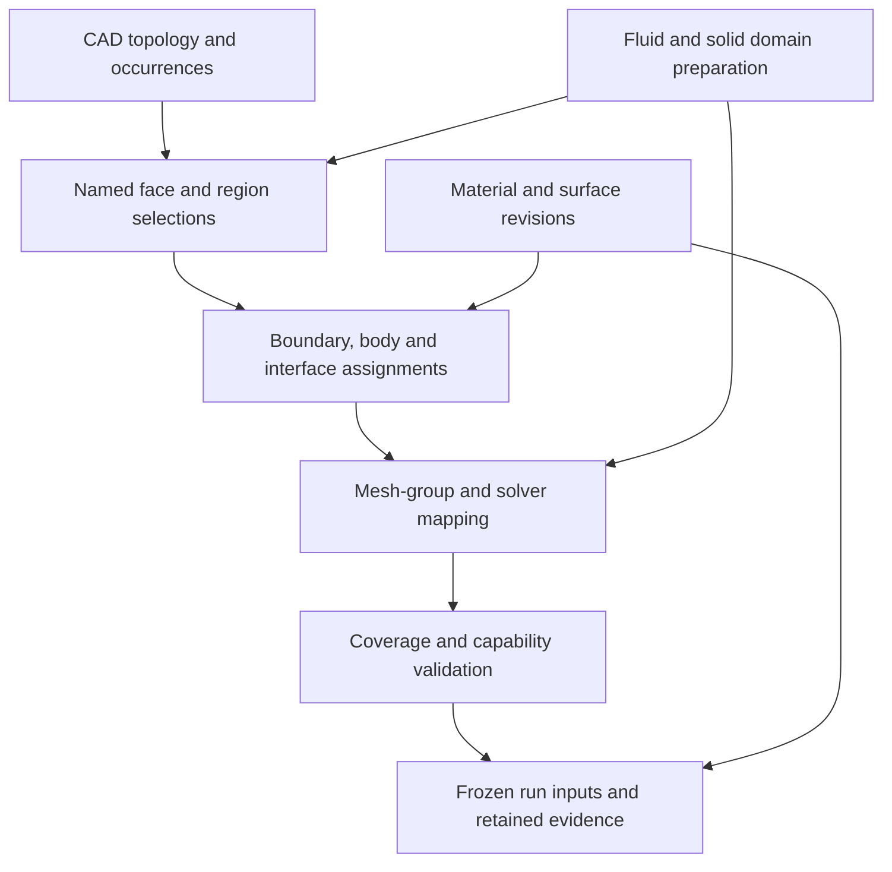

# Geometry-based multiphysics setup and internal materials

Research date: 2026-11-13. This is an original workflow and architecture synthesis,
based on public user documentation. Product source code, commercial applications,
screenshots, templates and material databases were not used as implementation inputs.
The survey covers major relevant environments, not every simulator on the market.
Older documentation establishes a documented workflow, not the exact layout of a current release.

## Read the findings

| Report | Coverage |
|---|---|
| [Boundary selection](simulation-boundary-selection.md) | Fluent, CFX, STAR-CCM+, COMSOL and SimScale; curved/hidden faces and flow-domain preparation |
| [Thermal and materials](thermal-materials-physics.md) | FLOEFD, SOLIDWORKS Flow Simulation, Icepak and SimScale; conduction, contact, radiation, gravity and motion |
| [Open simulation interfaces](open-simulation-gui-workflows.md) | ElmerGUI, BARAM, SALOME, code_saturne and OpenFOAM; practical selection and zone workflows |

Autodesk CFD also documents distinct volume/surface selection and reversible hiding
to reach enclosed components. Altair SimLab assigns inlets, outlets, walls and far-field
conditions to selected faces or face groups of volume meshes. These reinforce the
same distinction: selecting geometry, defining a fluid region and assigning a
solver boundary are separate operations. See the additional sources below.

## What the research changes in the design

The primary object is a persistent named selection of real CAD faces or regions.
A wall can be curved, trimmed, split across several features, or hidden inside an assembly.
It is not restricted to an axis-aligned box side. A viewport triangle is only a display
primitive; its ordinal must never become the saved identity of a simulation boundary.

| User intent | Selected entity | Saved assignment |
|---|---|---|
| Inlet, outlet, opening, wall, symmetry | Oriented boundary face set of a fluid region | Boundary condition with units, coordinate frame and field-specific values |
| Solid/fluid material | Body, occurrence or simulation volume | Material revision plus any local material-axis orientation |
| Surface radiation/coating | Face set and participating side | Surface finish and radiation model |
| Conduction across an interface | Paired region sides | One contact/interface relationship |
| Gravity, operating environment | Study or regional override | Environment and compatible density/buoyancy model |
| Initial fluid state | Fluid region | Initial temperature, pressure and velocity |
| Moving wall | Wall face set | Wall velocity or rotation |
| Translating/rotating coordinates | Named frame or fluid zone | Frame origin, axes, translation, angular velocity and convention |

Appearance, material grade, mass density and solver qualification are separate facts.
A silver appearance does not identify aluminium. Importing an engineering card does
not prove that a numerical adapter consumes its properties.

## Proposed mouse workflow

This workflow is a design target. The current field-results slice is not a CAD boundary picker.

1. Choose **Internal cavity** or **External environment** and the intended physics.
2. For an internal case, select a cavity seed and its openings. Preview a closed fluid
   volume, connectivity and disconnected cavities. Opening caps must be real preparation
   geometry with provenance. For external flow, size a surrounding fluid domain and
   identify excluded solids and any ground or symmetry planes.
3. Choose **Boundary faces**, **Bodies/regions**, or **Interfaces** as the selection filter.
   Hover previews the exact entity and owner; click selects, Ctrl adds/removes.
4. Expose enclosed faces using hide selected, isolate, show all, a section plane or a
   depth-ordered pick-through list. A tree entry and its viewport geometry highlight each other.
5. Optionally grow the selection by shared topology, exact surface continuity or feature
   ownership. Preview the growth and list its members before accepting it. A fillet or
   neighbouring face must not acquire an inlet simply because it is close in screen space.
6. Save the selection with a meaningful name. Show its face count, area, owner, adjacent
   region, side and outward-fluid normal arrows. A logical group can map to several mesh patches.
7. Select a boundary type and edit only the fields supported by the chosen adapter.
   Apply commits one command; Cancel and Escape discard the draft.
8. Review coverage, overlaps, interface pairing, unresolved references and inherited defaults.
   Resolve defects before exporting or running. Selecting geometry is not proof of a valid mesh.

A clipping plane only changes visibility. Its artificial cut cap is not a physical
boundary. Two sides of a baffle are separate assignments. Transparent display alone
must not silently make every object behind the pointer selectable.

For a curved inlet, **normal speed** and a **global velocity vector** have different
meanings. With outward-fluid unit normal n(x), positive inward speed U means
u(x) = -U n(x). A fixed global vector does not rotate with that normal.
For a prescribed volume flow Q, the adapter must integrate the normal flux over the
actual selected area. Show sign and units; do not turn a mass flow into a speed
without the required density and area model.

## Persistent model and solver mapping

These records are proposed additions, not an assertion that they already execute.

| Record | Minimum contents and invariants |
|---|---|
| Geometry reference | Document identity, occurrence path, stable body/face identity and geometry revision |
| Named selection | Stable ID, entity level, explicit members or reproducible selection rule, resolved/missing/ambiguous status |
| Simulation region | Internal/external preparation recipe, seed/caps/exclusions, fluid/solid role, connectivity receipt |
| Boundary assignment | Selection ID, region side, type, typed parameters, coordinate frame, adapter support status |
| Material assignment | Region/occurrence reference, immutable material snapshot or revision, orientation and validation receipt |
| Surface finish | Selection/side, emissivity model and validity, radiation participation and surroundings |
| Contact | Both sides, area/mapping, one resistance/conductance model and explicit units |
| Mesh mapping | CAD selection to stable mesher groups and generated solver patches, counts/areas and unmapped entities |
| Run snapshot | Geometry, mesh, selection, material and physics hashes plus adapter version and original artifacts |

Geometry regeneration must re-resolve exact references. If a face disappears or splits
ambiguously, retain the assignment as unresolved and stop the affected run. Never
reattach it to the nearest-looking face. Broad-phase acceleration may use exact body
bounds; final pick and model decisions must use the geometry kernel, not display meshes.

## Physics editors and validation

| Editor | Required distinctions |
|---|---|
| Inlet/outlet/opening | Static versus total/gauge/absolute pressure; one-way versus backflow; inward normal speed versus vector; thermal/species backflow data where required |
| Wall | Slip/no-slip, roughness, stationary/moving, thermal condition; default assignment visible in coverage audit |
| Conduction | Positive conductivity; scalar, orthotropic or full symmetric positive-definite tensor; local axes and body placement kept distinct |
| Heat generation | Total W, volumetric W/m³ and surface W/m² are different quantities; show selected volume/area |
| Contact | Total K/W, area-specific m²K/W, conductance W/(m²K), or layer thickness and conductivity; count the contact once |
| Radiation | Face/side, emissivity and its model, surface-to-surface exchange versus prescribed environment, temperature in kelvin |
| Gravity/buoyancy | Vector and named frame, density law, reference density/temperature and thermal expansion where needed |
| Motion | Initial velocity, inlet/freestream velocity, wall velocity and frame motion have separate records |

For orthotropic conduction, rotate material conductivity using K_world = R K_local R^T.
Show which axis is through the PCB thickness. A generic substrate is not an equivalent
populated board: stackup, copper coverage and vias require characterized effective properties.

A contact's area-specific resistance is thickness/conductivity for a homogeneous
one-dimensional layer. Its total resistance also depends on effective contact area.
Do not silently interchange resistance and conductance, or apply the same thin layer twice.
SimScale explicitly documents this double-layer trap.

An emissivity value belongs to a surface state, not automatically to every surface of
a bulk material. A polished, oxidized and coated face can share the same substrate.
Changing thermal conductivity must not invent an emissivity. Enclosure radiation needs
an appropriate exchange calculation; an ambient-radiation condition is a different model.

The study also needs a capability-gated radiation-model choice. Gray surface exchange
and radiation transported through a participating medium require different inputs.
The latter can require volumetric absorption/scattering and spectral properties;
those are not substitutes for a wall's emissivity. Show only models the selected
adapter actually implements, together with their required region and surface data.

Gravity alone is not natural convection: the selected energy and density/buoyancy
formulation must supply the coupling. Likewise, initializing velocity does not impose
an inlet, and rotating a wall does not create a rotating fluid reference frame.

## Internal library: reuse and current scope

SolidCraft already contains 59 physical-reference profiles in
`assets/render/physical/profiles.json`, with sources, conditions, original units and
native projection receipts. This work exposes that catalog in Multiphysics instead
of creating a second authoritative material store.

The intended delivered path is **Multiphysics → Material library → reference search →
review source/conditions/omissions → Create in design**. Creation uses the existing
`render.library.physical.prepare` and `material.create` commands. Project-local
materials use the existing editor, undo history and saved document representation.
The implementation's actual acceptance results are recorded separately in the
material-library verification report; this research document is not a test result.

| Library layer | Ownership and behavior |
|---|---|
| Shipped reference catalog | Immutable existing profiles; searchable offline; reference information is not certification |
| Design-owned material | Editable copy through material.create/edit; serialized with the design and undoable |
| Body assignment | Existing explicit material.assign operation; importing a definition does not assign a body |
| Portable user library | Existing solidcraft-library/2 import/export with revisions; distinct from the shipped catalog |
| Solver material snapshot | Future adapter binding; must freeze actual consumed properties and provenance with each run |

Native engineering cards support density, elasticity/strength, directional conductivity,
thermal expansion and specific heat. They do not currently represent fluid viscosity,
general temperature/pressure functions, surface emissivity or thermal contacts.
Unsupported profile quantities remain inspectable with an omission receipt.
Missing density or multiple candidate densities must refuse creation rather than
invent a midpoint. An engineering reference card remains candidate data after import.

The existing numerical cases still use their own scalar JSON inputs. A CAD material
assignment does not automatically alter those cases. This increment does not implement
general CAD fluid extraction, face-to-mesh boundary mapping or conjugate heat transfer.

## Material extension contract

Future fluid and thermal records should carry a stable ID/revision, designation/grade,
phase, property model, SI units, reference temperature and pressure, valid range,
uncertainty/quality, source/page and redistribution terms. A user-entered source claim
must not become a certified or redistribution-approved record automatically.

Temperature tables require strictly ordered finite temperatures and explicit
interpolation/extrapolation policy. Property values need not be monotonic.
Density, heat capacity and conductivity must remain physically admissible over the
used range. Distinguish dynamic viscosity from kinematic viscosity; derive one from
the other only with a compatible density at the same state.

Do not bundle competitor material catalogs or assume every publicly accessible
reference database is freely redistributable. NIST SRD has specific data terms.
Use the existing sourced profiles, authorized user records or individually reviewed
datasets; leave missing fluid properties unknown until a suitable source/model exists.

## Implementation order and acceptance gates

1. Expose the existing material catalog and design editor. Verify mouse import, duplicate
   refusal, undo/redo, save/reopen, project switching and no case/assignment side effects.
2. Add stable CAD face/region selection records. Verify a curved fillet, several inlet
   faces, a hidden inner wall and a changed/split feature. A stale reference must block Apply.
3. Add internal/external domain preparation and mesher mapping. Verify a closed cavity,
   a lid opening, disconnected cavities and a deliberately leaking enclosure.
4. Add capability-gated boundary and region editors. Verify every exported patch has
   the required conditions for every active field and that overlaps cannot silently win.
5. Bind material snapshots, energy, contacts, radiation and buoyancy to numerical adapters.
   Verify analytic conduction/contact/radiation cases, conservation, mesh refinement
   and integration against retained original artifacts before claiming physical validation.

The first gate is the current implementation task. The remaining gates are planned
architecture. No placeholder control should claim those later gates are complete.

Status, 2026-11-13: the portable records for gates 2 and 4, and the contact and
orthotropic parts of gate 5, exist in `crates/multiphysics/src/setup.rs` with tests.
The tests cover a curved fillet inlet, several inlet faces, a hidden internal rib, a split
feature, a deleted face and a double-counted contact. These records do not yet have
engine commands, a viewport picker, a kernel snapshot provider or a numerical adapter,
so gates 2–5 are not complete as user workflows.

## Additional official sources

- [Autodesk CFD: basic model interactions](https://help.autodesk.com/cloudhelp/2024/ENU/SimCFD-QuickStart/files/GUID-32F5ABA0-8FB6-4D22-9794-754B3EDE5D13.htm)
- [Altair SimLab: inlet](https://help.altair.com/simlab/help/en_us/topics/analysis/cfdinlet.htm)
- [Altair SimLab: outlet](https://2026.help.altair.com/2026.1/simlab/help/en_us/topics/analysis/CFDOutlet.htm)
- [Altair SimLab: far field](https://help.altair.com/simlab/help/en_us/topics/analysis/CFDFarfield.htm)
- [Altair SimLab: wall](https://help.altair.com/simlab/help/en_us/topics/analysis/CFDWall.htm)
- [SimScale: internal and external flow-volume extraction](https://www.simscale.com/knowledge-base/flow-volume-extraction/)
- [SimScale: contact resistance and thin layers](https://www.simscale.com/docs/simulation-setup/advanced-concepts/contact-resistance/)
- [Icepak: anisotropic conductivity and object orientation](https://ansyshelp.ansys.com/public/Views/Secured/Electronics/v242/en/Subsystems/Icepak/Content/Materials/DefiningAnisotropicThermalConductivityTensors.htm)
- [CFX: boundary location and coordinate/frame settings](https://ansyshelp.ansys.com/public/Views/Secured/corp/v251/en/cfx_pre/i1310482.html)
- [NIST SRD data terms](https://www.nist.gov/srd/public-law)
